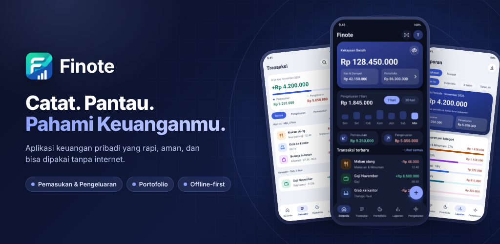
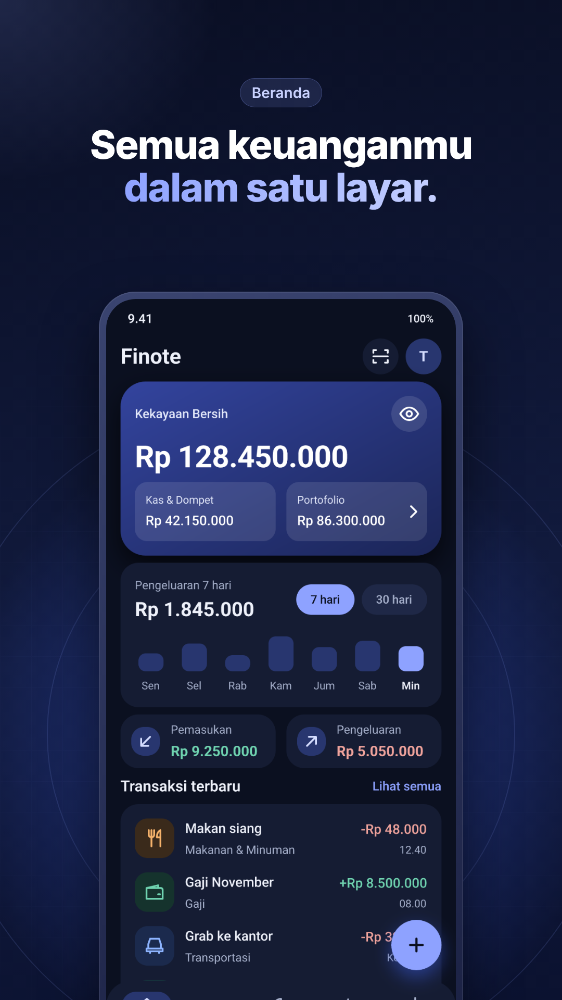
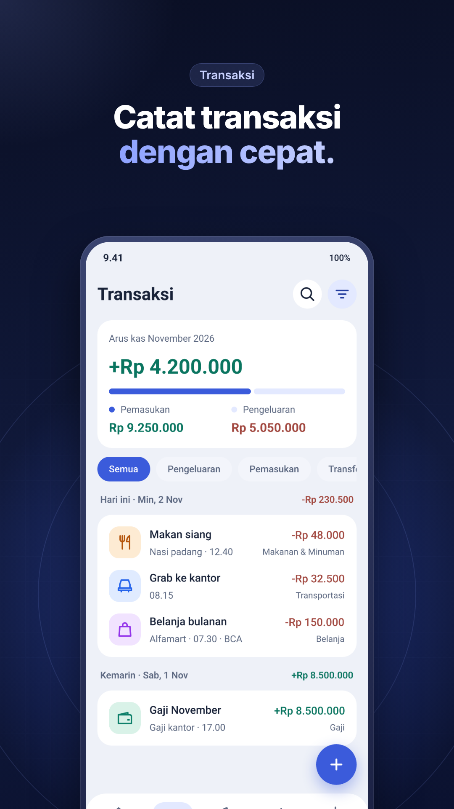
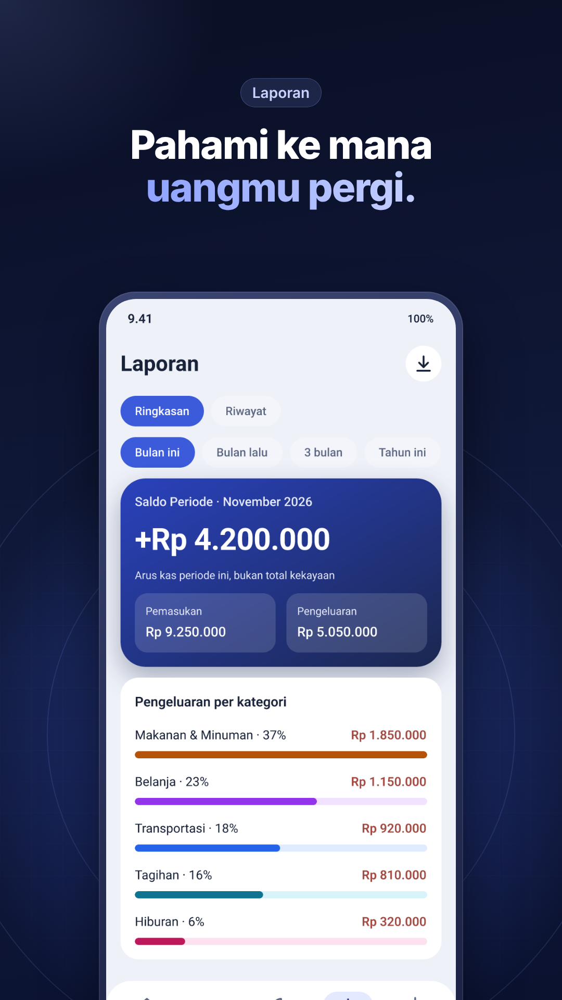
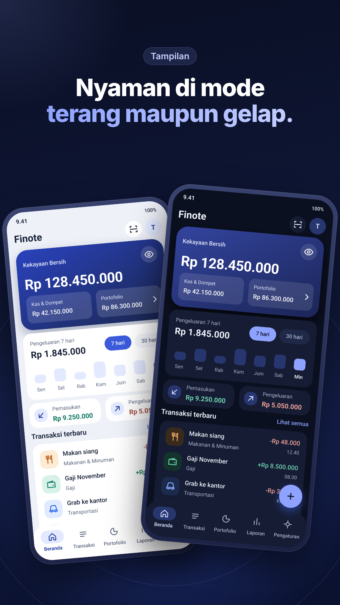

<div align="center">



# Finote

**Catat. Pantau. Pahami Keuanganmu.**

Aplikasi pencatatan keuangan pribadi yang sederhana, cepat, dan bisa dipakai tanpa internet.
Data Anda tetap di perangkat Anda.

<a href="https://play.google.com/store/apps/details?id=com.technowstack.finote">
  
</a>


</div>

---

## 📱 Tampilan

<div align="center">
  
  
  
  
</div>

## ✨ Fitur

### 💸 Pencatatan harian
- **Pemasukan & pengeluaran** dengan input cepat, nominal Rupiah bilangan bulat.
- **Kategori** dengan ikon dan warna khusus, terpisah untuk Pengeluaran dan Pemasukan.
- **Akun & dompet**: Tunai, Bank, E-Wallet, dan Tabungan.
- **Transfer antar akun**, tidak dihitung sebagai pemasukan atau pengeluaran.
- **Cari & filter** transaksi.
- **Scan struk** lokal *(eksperimental)*.

### 📊 Pahami keuangan
- **Kekayaan bersih**, saldo per akun, dan ringkasan pengeluaran 7 hari di Beranda.
- **Laporan bergrafik**: pengeluaran per kategori, pemasukan vs pengeluaran, saldo per akun, dan riwayat bulanan.
- **Portofolio aset**: saham, kripto, reksa dana, emas, dan lainnya, lengkap dengan posisi awal, pembelian, penjualan, dan penyesuaian. Harga pasar hanya diambil saat Anda menekan *Refresh harga*.

### 🔒 Data tetap milik Anda
- **Export laporan** ke Excel, PDF, dan teks.
- **Backup & restore** lokal.
- **Import** dari aplikasi Catatan Keuangan lama.
- **Kunci aplikasi** dengan PIN atau biometrik. Saat aktif, isi aplikasi disembunyikan dari Recent Apps.
- **Sembunyikan saldo** dengan satu ketukan.
- **Reset data** untuk mulai dari awal.

### 🎨 Nyaman dipakai
- Tema **Sistem, Terang, dan Gelap** dengan satu identitas warna.
- Tetap rapi saat ukuran huruf sistem diperbesar.

## 🧭 Prinsip

| | |
|---|---|
| 🙋 **Data milik pengguna** | Tidak perlu akun, tidak ada cloud untuk fitur inti. |
| 📴 **Offline-first** | Semua fitur utama jalan tanpa internet. |
| 💾 **Tersimpan lokal** | Data disimpan di perangkat; backup dan export untuk membawanya. |
| ✍️ **Pencatatan manual jadi fokus** | Cepat dicatat, mudah dipahami. |

Internet hanya dipakai saat Anda sendiri meminta harga pasar terbaru. AI, budget, transaksi berulang, dan cloud sync belum termasuk dalam versi ini.

## 🗺️ Riwayat versi

| Versi | Isi |
|---|---|
| **v1.0** | Fitur inti, export, backup, import, keamanan dasar |
| **v1.1** | Akun & transfer antar akun |
| **v1.2** | Visualisasi laporan |
| **v1.3** | Aset & investasi |
| **v1.4** | Tampilan baru: satu warna brand, ikon & warna per kategori, ringkasan 7 hari, sembunyikan saldo |

Detail per fase ada di [`STATUS.md`](STATUS.md). Scan struk masih eksperimental dan akan dipertahankan hanya jika hasil pengujian menunjukkan fitur ini aman dan cukup andal.

## 🛠️ Pengembangan

```bash
flutter pub get
dart run build_runner build --delete-conflicting-outputs
flutter analyze
flutter test
```

Test mencakup perhitungan keuangan, migrasi database, export, backup, layout di lebar 320dp dengan teks 1.3×, serta tema terang dan gelap.

Desain bersumber dari [`docs/design/`](docs/design/) (token, spesifikasi komponen, dan screenshot), dengan ringkasan di [Design System](docs/finote-audit/03-DESIGN-SYSTEM.md).

## 📚 Dokumentasi

| Produk | Pengembangan | Rilis |
|---|---|---|
| [Product Requirements](PRD.md) | [Developer Guide](DEVELOPER_GUIDE.md) | [Release Feature Matrix](docs/release_feature_matrix.md) |
| [Backlog](docs/backlog.md) | [Development Status](STATUS.md) | [Closed Testing Plan](docs/closed_testing_plan.md) |
| [Privacy Policy](docs/privacy_policy.md) | [Design System](docs/finote-audit/03-DESIGN-SYSTEM.md) | [Release Readiness](docs/release_readiness.md) |

---

<div align="center">

Dibuat oleh **Technowstack** · [Unduh di Google Play](https://play.google.com/store/apps/details?id=com.technowstack.finote)

</div>